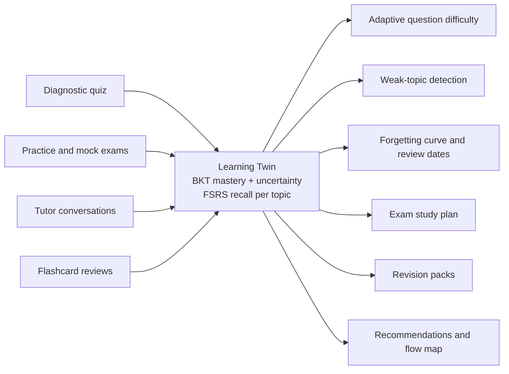
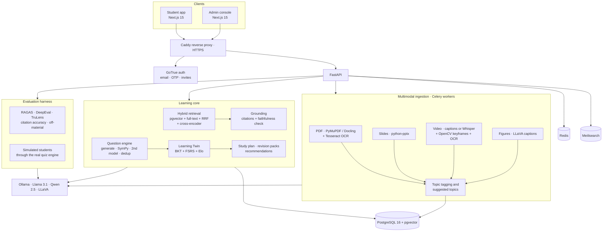

# IntelliNova

### A source-grounded, adaptive AI tutor that runs entirely on a school's own hardware

**IIT Mandi Multimodal AI Hackathon 2026 · Track D**

IntelliNova turns a school's own textbooks, slide decks and lecture videos into a tutor that cites the exact page, slide, figure or video moment behind every answer. It also tracks what each student knows and how fast they are forgetting it, and plans what they should study next. Every model (language, vision, speech, embeddings) runs locally through Ollama, so no student data is sent to a third-party AI API.

[▶ Demo video: INSERT YOUTUBE LINK] · [📄 Project overview (PDF)](docs/IntelliNova-Project-Overview.pdf) · [⚙ Setup guide](docs/SETUP.md) · [🏗 Architecture details](docs/ARCHITECTURE.md)

> **Demo scope.** IntelliNova runs a large language model, a vision model, speech recognition and an evaluation judge on a single machine. To keep the demo responsive on a laptop GPU (8 GB), we limited the demo content to one subject: **CBSE Class 10 Science, chapter "Electricity"**. Nothing in the system is tied to one subject. Boards, classes, subjects and chapters are data that staff add in the curriculum builder.

---

## Contents

[Why IntelliNova](#why-intellinova) · [Judge Quick Start](#judge-quick-start) · [Track D Requirement Mapping](#track-d-requirement-mapping) · [Key Innovations](#key-innovations) · [Personalization Engine](#personalization-engine) · [Evaluation Results](#evaluation-results) · [Results & Benchmarks](#results--benchmarks) · [Architecture](#architecture-diagram) · [Technical Highlights](#technical-highlights) · [Competitive Advantages](#competitive-advantages) · [Demo Walkthrough](#demo-walkthrough) · [Limitations](#known-limitations) · [Roadmap](#future-roadmap)

---

## Why IntelliNova

Students already use AI chatbots to study. Those chatbots answer from the open internet, can't show where an answer came from, and know nothing about the student. IntelliNova is built around five principles that address those gaps.

| Principle | What it means in IntelliNova |
|---|---|
| **Source-grounded tutoring** | Answers are built only from the school's own material. Every claim carries a citation `[n]` that opens the exact page, slide, figure or video timestamp. A sentence-level faithfulness check runs before the answer is shown. If the material doesn't cover the question, the tutor says so instead of guessing. |
| **Adaptive learning** | Practice difficulty follows each student's estimated mastery. Questions the student has already seen are avoided. Weak topics surface automatically in practice, revision packs and the study plan. |
| **Learning Twin** | Each student has a learner model per topic: a mastery estimate with an uncertainty band (Bayesian Knowledge Tracing) and a memory model of when they will forget it (FSRS). Quizzes, tutor conversations, flashcards and a diagnostic all update it. Practice, plans and revision all read from it. |
| **Privacy-first architecture** | All AI models are self-hosted (Ollama, faster-whisper, Piper, sentence-transformers). Students can request a data export, a correction or account deletion from inside the app. The student app and the admin console use separate sessions and roles. |
| **Evaluation-driven development** | An admin evaluation harness scores the tutor on a held-out test set with **RAGAS, DeepEval or TruLens**, plus citation accuracy and off-material handling. Simulated students then run through the real quiz engine to measure whether adaptivity helps. The results are meant to be checked before every update. |

---

## Judge Quick Start

**Setup (one time, about 10–20 minutes, mostly model downloads):**

```bash
cp .env.example .env                      # set the "change-me" values
docker compose --profile dev up -d --build
docker compose exec ollama ollama pull llama3.1:8b
docker compose exec ollama ollama pull qwen2.5:7b
docker compose exec ollama ollama pull llava:7b
```

Open <http://localhost>. Emails (sign-up codes, invites) arrive in Mailpit at <http://localhost:8025>. On Windows, the `windows/` folder has double-click **Start / Stop / Update** shortcuts. Full details are in [docs/SETUP.md](docs/SETUP.md).

**The 5-minute evaluation path:**

| # | Step | Where | What to look for |
|---|---|---|---|
| 1 | **Login** | `/admin/signup` creates the first admin (later staff sign-up is invite-only). | Separate, role-based admin console. |
| 2 | **Build the curriculum** | Admin › Curriculum: add *CBSE · Class 10 · Science* › chapter *Electricity* › topics, then **Publish**. | Topics, subtopics, prerequisites, versioned publishing. |
| 3 | **Upload sources** | Admin › Knowledge base › Add source: a textbook chapter PDF (e.g. NCERT Class 10 Science, Ch. 11). Optionally add slides or a lecture video. | The 6-stage pipeline, then content units linked to pages, tagged to topics, and **suggested topics** for material the curriculum doesn't cover yet. |
| 4 | **Ask the tutor** | Sign up as a student at `/signup` › Ask Tutor: *"State Ohm's law"*, then something off-syllabus. | Citations that open the exact page. An honest "not covered in your material" for the off-syllabus question. |
| 5 | **Generate a quiz** | Practice › pick topics › Generate. | Questions marked *Answer verified*, instant grading with key points, and a mastery change shown after each answer. |
| 6 | **View the learner model** | My Progress. | Per-topic mastery with an uncertainty band, *Weak / Developing / Mastered* status, and the forgetting curve with the next review date. |
| 7 | **View the evaluation dashboard** | Admin › Evaluation › Test set › Draft from material (or Import CSV) › Results › **Run evaluation**. | Six metrics against targets, per-question results, question-bank checks and simulated-student learning curves. Downloadable Report and CSV. |

> Processing a short chapter and writing the first quiz take a few minutes on a laptop GPU. A "running" indicator in the top bar tracks background work, so you can keep using the app meanwhile.

---

## Track D Requirement Mapping

| Track D Requirement | IntelliNova Implementation |
|---|---|
| **Multimodal knowledge base: textbooks** | PDF parsing (PyMuPDF, or Docling when installed) with Tesseract OCR for scanned pages, including Hindi. Text is split into content units that keep their page number. |
| **Multimodal knowledge base: slides** | python-pptx extracts slide text and embedded images, one unit per slide, each keeping its slide number. |
| **Multimodal knowledge base: lecture video** | YouTube captions when available, otherwise faster-whisper transcription. Uploaded videos also get OpenCV keyframe detection plus OCR of on-screen text. Units keep their timestamps. |
| **Diagrams and figures** | Figures are captioned by a local vision-language model (LLaVA) and become searchable, citable units. Numbered figures are processed first, and repeated images only once. |
| **Topic tagging and curriculum alignment** | Every unit is tagged with a topic, subtopic, key concepts and prerequisites, with confidence scores. Low-confidence tags go to a review queue. Material that fits no existing topic is grouped into **suggested topics**, which staff can add to the curriculum. |
| **Source-grounded Q&A** | Hybrid retrieval (pgvector plus Postgres full-text, fused by reciprocal rank, then a cross-encoder re-ranker). Answers cite `[n]` per claim. |
| **Citations to exact location** | Each citation opens the exact page, slide, figure or video timestamp in a source viewer, with the passage highlighted. |
| **Declining ungrounded answers** | A sentence-level faithfulness check runs against the retrieved sources. With *Sources only* on, unsupported answers are declined. With it off, a general answer is shown, clearly labelled as outside the material and never used in quizzes. |
| **Adaptive assessment: generation** | Questions (MCQ, numerical, short answer) are generated per topic from the source-linked units, and each keeps its source location. |
| **Adaptive assessment: quality control** | Numerical answers are re-derived with SymPy. Every answer key is cross-checked by a second model (qwen2.5). Near-duplicates are removed by embedding similarity. Only questions that pass are served. |
| **Adaptive assessment: difficulty** | Difficulty targets the student's BKT mastery, item difficulty is updated online (Elo/Rasch-style), and repeats are avoided. Modes: adaptive quiz, mock exam (timed) and diagnostic. |
| **Learner model** | Per-topic BKT mastery with uncertainty (pyBKT refit when installed). FSRS memory state and predicted recall per topic. Updated by quizzes, tutor conversations, flashcards and the diagnostic intake. |
| **Cold start** | Onboarding collects board, class, subjects, languages and goals, and offers a short diagnostic quiz to set initial mastery. |
| **Personalised recommendations** | Resources are ranked by topic coverage, language, quality, engagement, students' helpful votes and completion, each with a "why" line. Videos are auto-discovered and judged against the syllabus topic by the local LLM. |
| **System evaluation: RAG quality** | A held-out test set (imported CSV/JSON or drafted from the material) is scored by **RAGAS, DeepEval or TruLens**: faithfulness, answer relevancy, context precision and context recall. Citation accuracy and off-material handling are scored on top. |
| **System evaluation: learner model** | Six simulated student profiles with hidden IRT ability take real quizzes through the live quiz engine (inside a rolled-back transaction). This compares adaptive difficulty against a fixed-difficulty baseline. |
| **Optional: course flow map** | Every topic in teaching order, with prerequisite arrows, coloured by the student's mastery. |
| **Optional: revision material** | Study AI turns a lecture, PDF, slides or pasted text into full notes, short notes, key concepts, formulas, a concept map, flashcards, a revision sheet, an audio brief and a slide deck. One-click **revision packs** do the same for weak topics. |
| **Optional: study schedule** | An exam-date study plan, rebuilt daily from mastery, course order and FSRS-predicted recall on exam day. |
| **Optional: voice tutoring** | Hands-free voice mode: Whisper speech recognition on the server, Piper text-to-speech, in English and Hindi, with Hinglish support. |

---

## Key Innovations

1. **Learning Twin.** Our name for the per-student learner model. It holds what the student knows (BKT mastery with uncertainty) and when they will forget it (FSRS). It powers practice, revision, the study plan and progress views, so personalization is one consistent model rather than a set of separate heuristics.
2. **BKT + FSRS learner model.** BKT estimates *whether* a topic is learned. FSRS estimates *how long it will be remembered*. Combining them lets IntelliNova separate "never learned" from "learned but fading", and treat each differently.
3. **Forgetting curve.** Each topic's predicted recall is plotted over time, with the next review set for when recall is predicted to drop to 90%, well before the 70% line.
4. **Revision Packs.** One click builds notes, flashcards, a concept map and a slide deck for the student's weakest topics, from the class material, with every note linked back to its source.
5. **Adaptive Study Plans.** Given an exam date and the time available each day, IntelliNova produces a day-by-day schedule: new topics in course order, targeted practice for weak ones, spaced reviews timed to the forgetting curve, and a final revision window ranked by predicted recall on exam day.
6. **Curriculum Builder.** Versioned publishing, prerequisite graphs, and **topics suggested automatically** from uploaded material. The AI proposes and staff approve.
7. **Multimodal RAG.** Textbooks, slides, lecture video, on-screen text and diagrams all become one index of source-linked units. A citation can point to a page, a slide, a figure or a video moment.
8. **Self-hosted AI.** Llama 3.1 8B (generation), Qwen 2.5 7B (verification and judge), LLaVA 7B (figures), faster-whisper (speech) and Piper (voice) all run on one machine with an 8 GB GPU. Background work pauses while a student waits for the tutor, and runs one job at a time to fit that hardware.

---

## Personalization Engine

Personalization in IntelliNova is one closed loop. Every interaction updates the Learning Twin, and every feature reads from it.



| Capability | How it works |
|---|---|
| **Mastery tracking** | Bayesian Knowledge Tracing per student and topic, with an uncertainty band that narrows as evidence grows. Shown as *Weak* (<0.5), *Developing* (0.5–0.8) or *Mastered* (≥0.8). Each answer shows the mastery change, e.g. `0.25 → 0.36`. |
| **Weak-topic prediction** | Topics with low BKT mastery are flagged *Weak*. Topics the student once knew are flagged when FSRS predicts recall below 70%. Both feed "Needs attention" on Home, "Practice weak topics" on My Progress, revision packs and the study plan. |
| **Forgetting curve** | FSRS memory state per topic. Predicted recall is plotted over time, and reviews are scheduled before recall drops below 90%. |
| **Study recommendations** | "Today's plan" and the exam study plan interleave new learning, targeted practice (weakest first) and spaced reviews. Resource recommendations explain *why* each item is suggested. |
| **Personalized quiz generation** | Topics, question types and difficulty adapt to the student's mastery. Item difficulty is re-estimated online with every answer, and questions already seen are avoided. |
| **Learning Twin** | The single per-student model behind all of the above, visible to the student on **My Progress**, so the personalization is explainable rather than a black box. |

**Measured, not assumed.** The evaluation harness runs six simulated student profiles (struggling, strong, Hindi-first, irregular, new, exam-in-two-weeks) through the real quiz engine. It compares mastery gain under adaptive difficulty with a fixed-difficulty baseline. See [Results & Benchmarks](#results--benchmarks).

---

## Evaluation Results

All metrics are produced by **Admin › Evaluation** and can be downloaded as a Markdown report or CSV. The harness uses a held-out test set with reference answers and the expected source location of each answer, plus off-material questions that the tutor should decline.

**Run configuration:** generator `llama3.1:8b` · judge `qwen2.5:7b` · embeddings `intfloat/multilingual-e5-small` · re-ranker `cross-encoder/mmarco-mMiniLMv2` · top-k 6 · context 8,192 tokens · test set: [INSERT N] questions, [INSERT N] off-material.

| Metric | Framework | Target | Result |
|---|---|---|---|
| Faithfulness | RAGAS | 0.85 | [INSERT VALUE] |
| Answer relevancy | RAGAS | 0.85 | [INSERT VALUE] |
| Context precision | RAGAS | 0.80 | [INSERT VALUE] |
| Context recall | RAGAS | 0.80 | [INSERT VALUE] |
| Faithfulness | DeepEval | 0.85 | [INSERT VALUE] |
| Answer relevancy | DeepEval | 0.85 | [INSERT VALUE] |
| Contextual precision | DeepEval | 0.80 | [INSERT VALUE] |
| Contextual recall | DeepEval | 0.80 | [INSERT VALUE] |
| Citation accuracy (expected vs cited location) | IntelliNova | 0.85 | [INSERT VALUE] |
| Off-material handling (correctly declined or labelled) | IntelliNova | 0.90 | [INSERT VALUE] |
| Question verification rate (verified ÷ generated) | IntelliNova | n/a | [INSERT VALUE] |
| Weak-topic detection accuracy | IntelliNova (planned metric) | n/a | [INSERT VALUE] |
| Average / 90th-percentile answer time | IntelliNova | n/a | [INSERT VALUE] s / [INSERT VALUE] s |

> Scores depend on the local models and the test set. When a framework can't produce a metric (TruLens has no context recall, for example), IntelliNova's built-in LLM judge fills it in and the run page says how many. Weak-topic detection accuracy is not yet computed by the harness. It is planned as agreement between the learner model's *Weak* status and the simulated students' hidden ability.

---

## Results & Benchmarks

### Retrieval evaluation

| Measure | Result |
|---|---|
| Context precision (RAGAS) | [INSERT VALUE] |
| Context recall (RAGAS) | [INSERT VALUE] |
| Citation accuracy by source type: textbook page / slide / video timestamp / figure | [INSERT VALUE] / [INSERT VALUE] / [INSERT VALUE] / [INSERT VALUE] |

### Grounding evaluation

| Measure | Result |
|---|---|
| Faithfulness (RAGAS / DeepEval) | [INSERT VALUE] / [INSERT VALUE] |
| Share of in-material questions answered from material | [INSERT VALUE] |
| Off-material questions declined or labelled | [INSERT VALUE] |

### Assessment quality (question bank checks)

| Measure | Result |
|---|---|
| Questions generated | [INSERT VALUE] |
| Verified by both checks (solver + second model) | [INSERT VALUE] |
| Held back: models disagreed | [INSERT VALUE] |
| Rejected by the SymPy solver | [INSERT VALUE] |
| Near-duplicates removed | [INSERT VALUE] |

### Learner-model evaluation and simulation results

Six profiles × [INSERT N] sessions, run through the live quiz engine.

| Profile | Start mastery | End mastery | Gain | Question repetition |
|---|---|---|---|---|
| Struggling with maths | [INSERT VALUE] | [INSERT VALUE] | [INSERT VALUE] | [INSERT VALUE] |
| Strong, fast learner | [INSERT VALUE] | [INSERT VALUE] | [INSERT VALUE] | [INSERT VALUE] |
| Hindi-first learner | [INSERT VALUE] | [INSERT VALUE] | [INSERT VALUE] | [INSERT VALUE] |
| Irregular, skips days | [INSERT VALUE] | [INSERT VALUE] | [INSERT VALUE] | [INSERT VALUE] |
| New student, no history | [INSERT VALUE] | [INSERT VALUE] | [INSERT VALUE] | [INSERT VALUE] |
| Exam in two weeks | [INSERT VALUE] | [INSERT VALUE] | [INSERT VALUE] | [INSERT VALUE] |
| **Mean mastery gain: adaptive vs fixed baseline** | | | **[INSERT VALUE] vs [INSERT VALUE]** | |

> The simulation runs on the real quiz engine once each topic has at least 8 verified MCQ or numerical questions (**Question bank › Prepare**). Until then it falls back to a statistical model and labels the run accordingly.

**Reproduce:** Admin › Evaluation › Test set (Import or Draft from material) › Question bank › Prepare › Results › choose RAGAS, DeepEval or TruLens › **Run evaluation** › **Report**.

---

## Architecture Diagram



More detail on each component and the design decisions: [docs/ARCHITECTURE.md](docs/ARCHITECTURE.md).

---

## Technical Highlights

| Technology | Role in IntelliNova |
|---|---|
| **FastAPI** | API for the student app and admin console, with role-based access and httpOnly-cookie sessions. |
| **PostgreSQL + pgvector** | Content units with embeddings (HNSW index), full-text search, the learner model, the question bank and evaluation runs, all in one database. |
| **Ollama** | Serves every LLM locally with JSON-schema structured output: generation, verification, judging and vision. |
| **Whisper (faster-whisper)** | Transcribes lectures without captions and the student's spoken questions, on the server. |
| **RAGAS · DeepEval · TruLens** | Selectable per run. All three use the local judge model, so evaluation is also fully self-hosted. |
| **BKT (pyBKT)** | Per-topic mastery with uncertainty. Parameters are refit from real answers when pyBKT is installed. |
| **FSRS (py-fsrs)** | Memory state and predicted recall per topic. Drives review timing and the forgetting curve. |
| **Meilisearch** | Typo-tolerant search over chapters, topics, resources, exams and careers, with "did you mean". |
| **Celery + Redis** | Background ingestion, AI generation, evaluation and video discovery on separate queues. Live progress appears in the UI. |
| **SymPy** | Re-derives numerical answers before a question is served. |
| **Next.js 15** | Student app, admin console and landing page. Installable, with dark and light themes, mobile-friendly. |

**Engineering quality.** 82 backend integration tests run against real Postgres, Redis, Meilisearch and GoTrue, with only the LLM replaced by deterministic fakes. Browser end-to-end checks cover the student and admin flows. Database changes go through Alembic migrations, and the stack is a one-command Docker Compose deployment.

---

## Competitive Advantages

| | Generic AI chatbots | Standard RAG tutors | LMS platforms | **IntelliNova** |
|---|---|---|---|---|
| Answers from the school's own material | No | Yes | No AI tutor | **Yes** |
| Citation to exact page, slide, figure or timestamp | No | Usually document-level | No | **Yes, opens the exact location** |
| Declines or labels off-material answers | No | Rarely | No | **Yes, measured as a metric** |
| Understands diagrams and lecture video | Partly | Usually text only | No | **Yes, LLaVA captions + Whisper + OCR** |
| Verified assessment questions | No | Rarely | Manual question banks | **Yes: SymPy + second model + dedup** |
| Per-student learner model | No | No | Grades only | **Yes, BKT + FSRS Learning Twin** |
| Spaced repetition and exam study plans | No | No | Rarely | **Yes** |
| Built-in quality evaluation | No | Rarely | No | **Yes, RAGAS / DeepEval / TruLens + simulation** |
| Student data stays on school servers | No | Depends on the LLM API | Usually | **Yes, all models self-hosted** |
| Hindi and Hinglish | Yes | Varies | Varies | **Yes, text and voice** |

---

## Demo Walkthrough

The sequence we recommend for judges, about 5 minutes, chosen to show the most value per minute.

| Time | Action | What it proves |
|---|---|---|
| 0:00 | **Admin › Knowledge base**: show the processed textbook, a content unit with its page, topic, subtopic and prerequisites, and a **suggested topic**. | Multimodal knowledge base and curriculum alignment |
| 0:45 | **Student › Ask Tutor**: *"State Ohm's law."* Click citation `[1]`. | Grounded answer and exact-location citation |
| 1:15 | Ask *"Who won the 2011 Cricket World Cup?"* with *Sources only* on. | Honest decline instead of a hallucination |
| 1:40 | **Practice**: generate an adaptive quiz and answer one question partly correctly. | Verified questions, rubric feedback, a mastery update |
| 2:30 | **My Progress**: open the weak topic's forgetting curve. | Learning Twin: BKT mastery with uncertainty, FSRS recall |
| 3:00 | **Study Plan**: enter an exam date and build the plan. | Adaptive schedule from mastery and forgetting curves |
| 3:30 | **Study AI**: open a generated pack (notes, concept map, flashcards, revision sheet). | Revision material linked to the source |
| 4:00 | **Admin › Evaluation › Results**: metrics vs targets, per-question results, question-bank checks, simulated students. | Quantitative system evaluation |
| 4:45 | Download the **Report**. | Reproducible, auditable results |

A recorded walkthrough of the full flow (8½ minutes, subtitled) is linked at the top of this page.

---

## Research Foundations

| Component | Basis |
|---|---|
| Mastery estimation | Bayesian Knowledge Tracing: Corbett & Anderson (1994), *Knowledge tracing: Modeling the acquisition of procedural knowledge* |
| Review scheduling | FSRS (Free Spaced Repetition Scheduler): Ye et al. (2022), *A Stochastic Shortest Path Algorithm for Optimizing Spaced Repetition Scheduling*, KDD |
| Forgetting | Ebbinghaus (1885) forgetting curve. Retrieval practice: Roediger & Karpicke (2006) |
| Interleaved study plans | Rohrer & Taylor (2007), *The shuffling of mathematics problems improves learning* |
| Item difficulty | Elo rating in adaptive learning systems: Pelánek (2016) |
| Hybrid retrieval | Reciprocal rank fusion: Cormack, Clarke & Büttcher (2009) |
| RAG evaluation | RAGAS: Es et al. (2024), *RAGAS: Automated Evaluation of Retrieval Augmented Generation*, EACL |
| Simulated learners | Item response theory (Rasch model) for the hidden ability of simulated students |

---

## Known Limitations

- **Hardware-bound speed.** With 7–8B models on an 8 GB GPU, a tutor answer takes seconds, and processing a figure-heavy textbook takes minutes. Background work yields to the tutor, and very slow jobs stop cleanly with a retry option.
- **Answer quality depends on the local model.** Larger models (`LLM_MODEL`) improve notes and questions. Re-run the evaluation after changing models.
- **The simulation needs a prepared question bank.** Until each topic has at least 8 verified questions, the learner-model simulation uses a statistical model and says so.
- **YouTube reading** can be rate-limited by YouTube ("confirm you're not a bot"). Videos with captions still work. See [docs/SETUP.md](docs/SETUP.md).

---

## Future Roadmap

| Item | Description |
|---|---|
| **AI Learning Twin** | Extend the learner model into a predictive twin that answers "what if" questions, such as "if I study X today, how ready will I be on exam day?", and explains its predictions. |
| **Whiteboard Tutor** | Students photograph handwritten working. The vision model reads it step by step and points to the exact mistake, with a citation to the relevant page. |
| **Exam Predictor** | Estimate exam readiness per chapter from mastery, predicted recall and past paper patterns, with confidence intervals. |
| **Parent Analytics** | A consent-based weekly summary for parents: time studied, topics improving, topics at risk. |
| **Advanced Simulations** | Larger simulated cohorts, calibrated against real (anonymised) student data, to tune BKT and FSRS parameters per school. |

---

## Why IntelliNova is a Strong Track D Submission

- **Knowledge Base & Grounding:** textbooks, slides, video, on-screen text and diagrams become one source-linked index. Every claim is cited to an exact location, and unsupported answers are declined or clearly labelled.
- **Assessment Quality:** questions are generated from the material and served only after a SymPy re-derivation, a second-model cross-check and de-duplication. Verification outcomes are reported in the evaluation dashboard.
- **Personalization Effectiveness:** a single Learning Twin (BKT + FSRS) drives adaptive difficulty, weak-topic detection, forgetting curves, revision packs and exam study plans. Its benefit is measured with simulated students against a fixed baseline.
- **User Experience & Demo:** a complete, polished student app and admin console, with voice, Hindi and Hinglish, mobile layouts, and background jobs that never block the student.
- **System Evaluation:** RAGAS, DeepEval and TruLens, plus citation accuracy and off-material handling, with per-question drill-down and downloadable reports, built into the product rather than run as a one-off script.
- **Technical Implementation:** fully self-hosted, one-command deployment, a tested backend (82 integration tests), and engineering for real school hardware.

IntelliNova is built for real schools rather than only for a demo: the school's own content, private by design, and checkable before each update.

---

<sub>Setup, configuration, development and project layout: [docs/SETUP.md](docs/SETUP.md) · Component details and design decisions: [docs/ARCHITECTURE.md](docs/ARCHITECTURE.md)</sub>
